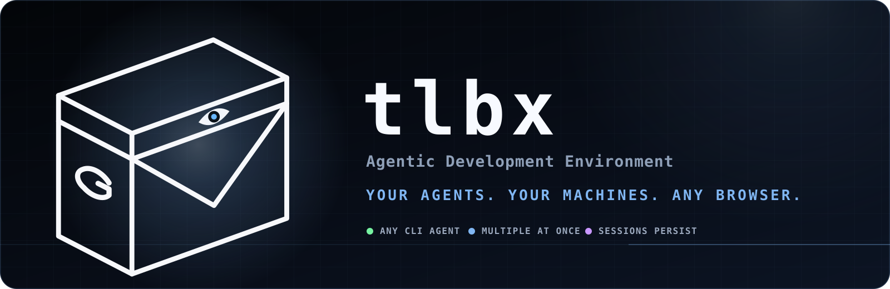
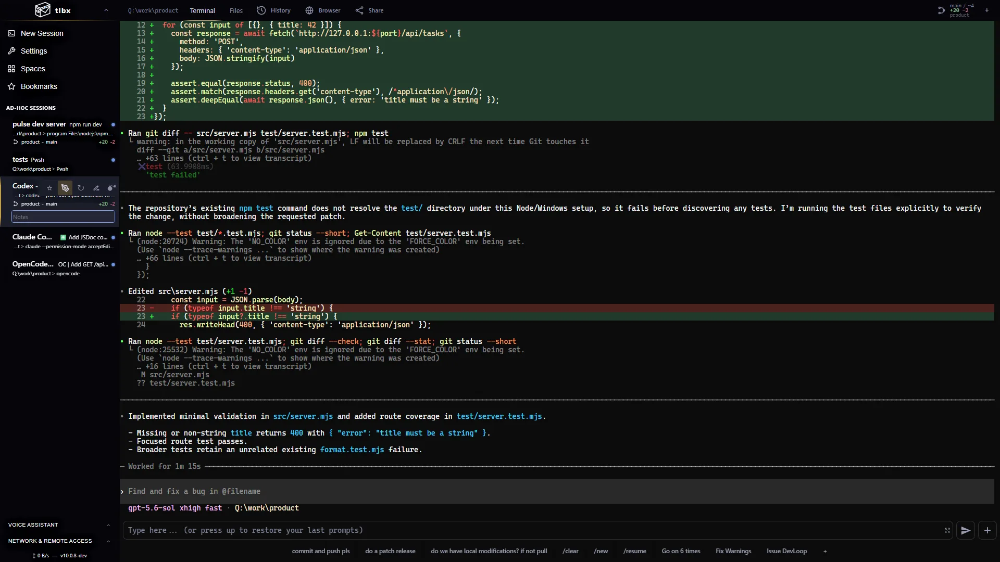
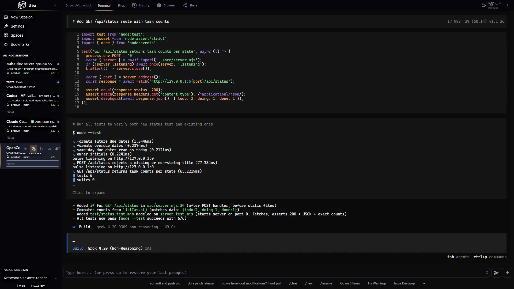
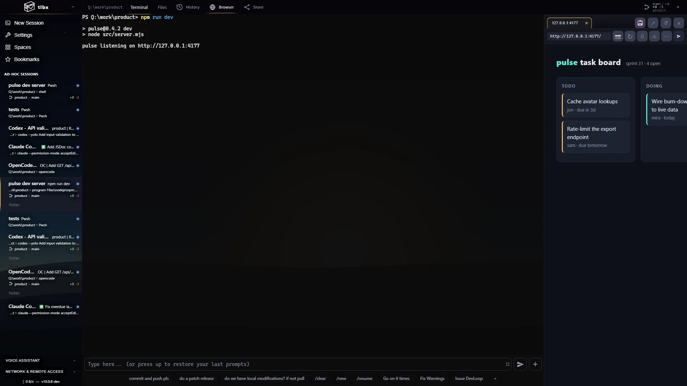
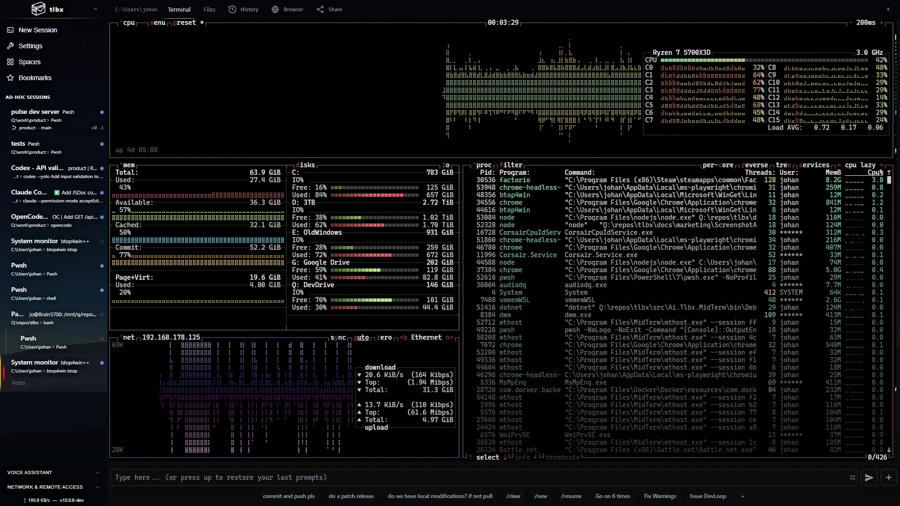

<p align="center">
  
</p>

<p align="center"><strong>Agentic Development Environment (ADE)</strong>&nbsp;&nbsp;·&nbsp;&nbsp;say &ldquo;toolbox&rdquo;</p>

<p align="center">
  <a href="https://tlbx.ai"><strong>Website</strong></a>
  ·
  <a href="#install"><strong>Install</strong></a>
  ·
  <a href="#working-with-agents"><strong>Working with agents</strong></a>
  ·
  <a href="#private-remote-access"><strong>Remote access</strong></a>
  ·
  <a href="https://lnk.tlbx.ai"><strong>tlbx Link</strong></a>
  ·
  <a href="https://tlbx.ai/security"><strong>Security</strong></a>
  ·
  <a href="https://tlbx.ai/features"><strong>All features</strong></a>
</p>

<p align="center">
  <a href="https://github.com/tlbx-ai/tlbx/releases/latest"></a>
  <a href="LICENSE"></a>
  
</p>

# tlbx — your Agentic Development Environment.

tlbx is a free, open-source **ADE** for launching agents, giving them tasks, following their progress and verifying results. It brings prompts, agent sessions, terminals, files, Git changes and your running app into one browser workspace on Windows, macOS and Linux.

An **IDE** integrates the tools you use to write code. An **Agentic Development Environment** integrates the tools you use to **direct agents**: assign work, supply context, answer questions, review changes and check outcomes. Coding is a core use case; research, scripts and other tasks supported by your agents fit the same workflow.

Run Codex, Claude Code, OpenCode and other agents on your own machines. Open the workspace from your desktop, tablet or phone, directly or through **[tlbx Link](https://lnk.tlbx.ai)**. Tools keep running when you close the browser, while the host stays awake and online. Your agent provider's usual charges still apply.

**[Install tlbx](#install)** · **[Explore the features](https://tlbx.ai/features)** · **[How it works](https://tlbx.ai/architecture)**

## Product screenshots

Follow agent conversations, review changes and check the running app in one browser tab.

<p align="center">
  
</p>

<p align="center">
  
</p>

<p align="center">
  
</p>

<p align="center">
  
</p>

## Two session types, one workspace

| Session type | Use it for | What tlbx renders |
| ------------ | ---------- | ----------------- |
| **Terminal Session** | Shells, command-line agents, editors, tests and servers | Your usual terminal, with output retained on the host |
| **Agent Controller Session** | Supported coding agents | A conversation view with tool calls, code changes, questions and approval buttons |

Choose the session type when you launch a tool. Both share the sidebar, files, Git view and app preview. [See supported agents](https://tlbx.ai/agent-controller).

## Any shell, any terminal app

Use **PowerShell, bash or zsh**, and terminal apps such as `btop`, `vim`, `lazygit` and database shells. Split sessions into panes to watch a build, edit files and run commands side by side.

<p align="center">
  
</p>

## Working with agents

Keep several agents running and make their work easier to follow:

- **Organize sessions:** name, split, reorder and bookmark agents, shells and servers.
- **Send screenshots:** `Ctrl+V` / `Cmd+V` uploads an image and gives the terminal its file path. Agent Controller adds it as an attachment.
- **Write longer prompts:** use multiline input, saved drafts, file attachments and scheduled follow-ups.
- **Follow progress:** see session activity and requests for attention; supported Agent Controller runtimes expose tool calls, questions, approvals and changes.
- **Reuse input:** open **History** (`Alt+H`) to resend commands, prompts, images or files.
- **Let agents use the workspace:** the `mt` helpers let them send prompts, read terminal output and inspect or control the app preview.
- **Check the result:** open your app beside the agent, try different window sizes and inspect screenshots or browser logs.
- **Continue elsewhere:** reconnect to the same work from another browser.

Agent Controller has built-in launch options for **Codex**, **Claude Code**, **Grok Build**, **OpenCode**, **Google Antigravity**, **Gemini CLI** and **GitHub Copilot CLI**. Features depend on the agent and its configured provider. You can add compatible [ACP](https://agentclientprotocol.com/) agents through `acp-agents.json`. **Claude Code** uses the official Claude Agent SDK; **OpenCode** uses its native HTTP/SSE server and requires CLI 1.14.19 or newer.

## Access your working machines

Install tlbx on each workstation or server you want to use. Open them in separate browser tabs, or connect them through tlbx's Hub. Each machine keeps its own files, tools and sessions.

## Install

Run one command on the machine where your tools should run. The installer sets up tlbx with password-protected HTTPS and updates.

**macOS / Linux**

```bash
curl -fsSL https://get.tlbx.ai/install.sh | bash
```

**Windows PowerShell**

```powershell
irm https://get.tlbx.ai/install.ps1 | iex
```

Open the address printed by the installer. Choose service mode to start tlbx automatically after login or reboot; user mode needs no administrator access. Running programs still require the host to stay awake.

These commands install the current stable release. Add `--dev` on macOS/Linux or `-Dev` on Windows only when you explicitly want the prerelease channel.

## Private remote access

**[tlbx Link — lnk.tlbx.ai](https://lnk.tlbx.ai)** opens your real tlbx workspace through encrypted WebRTC. A direct connection is preferred; relay fallback carries encrypted traffic when the networks prevent a direct path. The host needs no inbound port forwarding. Link is available in the current **dev channel**; the install commands above default to stable.

1. On the host, open `https://localhost:<port>` and go to **Settings → Security & Access → tlbx Link**, or open `https://localhost:<port>/connect.html` directly. Confirm the installation password and generate the connection files.
2. Open Link and upload the **public registration** file. Import the **private access** file in a trusted browser, then choose the saved computer.
3. Return from the same browser profile or install Link as a PWA. Each computer has its own access key; the overview keeps your saved machines together.

Private access keys are saved as non-extractable WebCrypto keys in that browser profile, not uploaded to Link. Clearing browser data removes the saved access. Keep the private access file secure: it grants access until revoked or replaced locally on the host. Key generation requires direct HTTPS localhost access and a fresh installation-password confirmation; Link, LAN, preview and proxy requests cannot generate keys.

Link currently buffers HTTP request/response bodies up to 20 MiB; streaming HTTP responses such as server-sent events are not supported through the tunnel. Direct HTTPS remains available for those workflows.

You can also connect host and client devices through a trusted LAN or a private VPN such as [Tailscale](https://tailscale.com/), then open the host's private tlbx address in your browser.

Keep HTTPS and password authentication enabled. Restrict network access to the people and devices that need it, and keep tlbx and your VPN updated.

Cloudflare Tunnel, nginx/Caddy, LAN, and other private-network setups also work.

> [!IMPORTANT]
> Repositories, credentials and processes stay on your host. Coding agents may send data to their model provider according to their configuration and terms.

## Where things run

| Part          | Behavior                                                                                   |
| ------------- | ------------------------------------------------------------------------------------------ |
| **Host**      | Your workstation or server runs tlbx and your tools |
| **Execution** | `mthost` runs terminals; `mtagenthost` runs Agent Controller sessions |
| **Client**    | A browser on your desktop, tablet or phone |
| **Lifetime**  | Sessions keep running when the browser disconnects, while the host stays awake |
| **Context**   | Files, Git changes, retained output, notes and previews belong to the session |

Closing a browser keeps sessions running. Shutting down the host stops its processes.

## Quick local trial

For a temporary local session:

```bash
npx @tlbx-ai/midterm
```

The launcher downloads the stable native binary and opens a browser. Use the native installer above for a service you can return to. The npm launcher is published separately and may lag behind native releases.

## Architecture and source

```text
browser anywhere
   ├── HTTPS / WebSocket ──► tlbx on home workstation ──► agents / repos / apps
   └── HTTPS / WebSocket ──► tlbx on office laptop ─────► agents / repos / apps
```

tlbx uses .NET 10 Native AOT, TypeScript and xterm.js.

Previously named **MidTerm**. Existing installations update in place; executable names such as `mt`, `mthost` and `mtagenthost` remain compatible.

- [Architecture](docs/ARCHITECTURE.md)
- [Feature guide](docs/FEATURES.md)
- [Contributing](docs/CONTRIBUTING.md)

## Security and release integrity

Report vulnerabilities through [GitHub private vulnerability reporting](https://github.com/tlbx-ai/tlbx/security/advisories/new), not a public issue. The [security policy](SECURITY.md) describes disclosure handling and the [support policy](SUPPORT.md) identifies the supported release lines.

Every native release archive has a matching platform-specific SPDX SBOM plus GitHub build-provenance and SBOM attestations. Installers and the built-in updater additionally verify a signed manifest and every packaged-file hash. See [Release integrity](docs/RELEASE-INTEGRITY.md) for verification commands and trust boundaries.

### Community client

[midterm-gtk](https://github.com/elsirion/midterm-gtk) is an independent,
community-maintained GTK4/libadwaita desktop client with VTE terminals. It
connects through tlbx's REST and WebSocket mux/state channels. It is
unofficial and is not maintained or support-guaranteed by the tlbx project.

```bash
git clone https://github.com/tlbx-ai/tlbx.git tlbx
cd tlbx
dotnet build src/Ai.Tlbx.MidTerm/Ai.Tlbx.MidTerm.csproj
```

Uninstallers: [macOS/Linux](https://get.tlbx.ai/uninstall.sh) · [Windows](https://get.tlbx.ai/uninstall.ps1)

tlbx is [GNU AGPL v3](LICENSE). Commercial licensing is available from [tlbx-ai](https://github.com/tlbx-ai).
